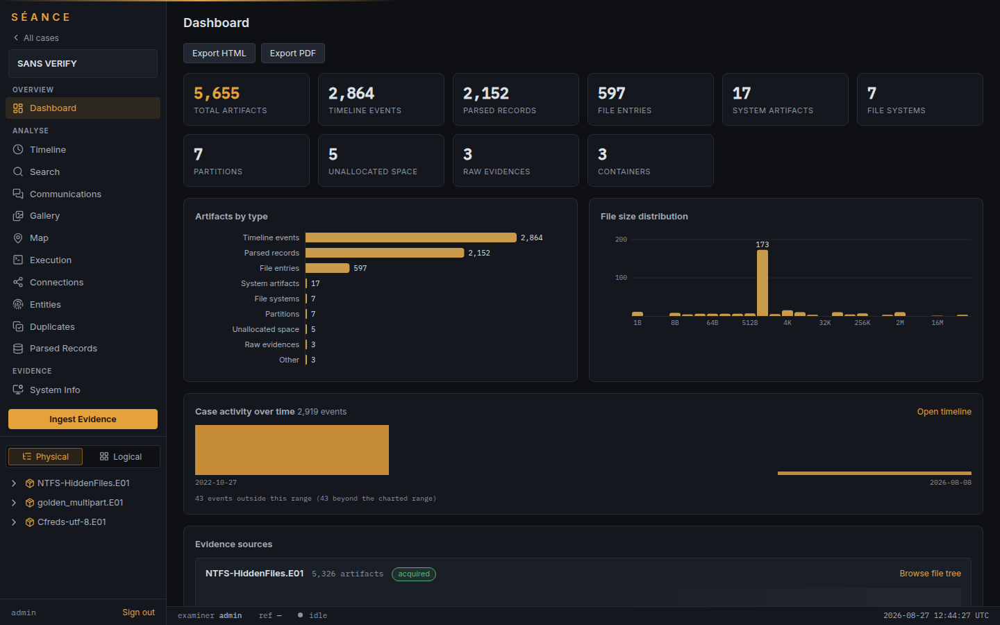
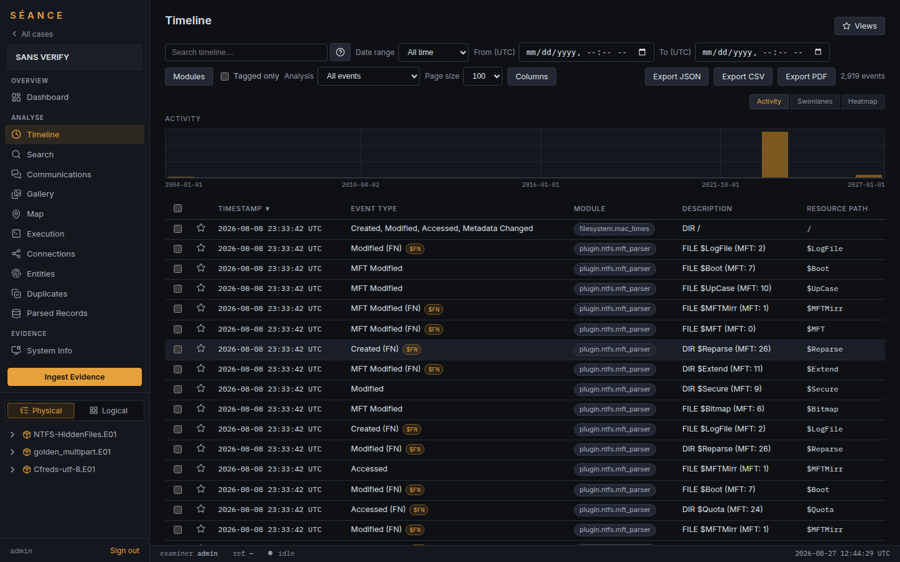
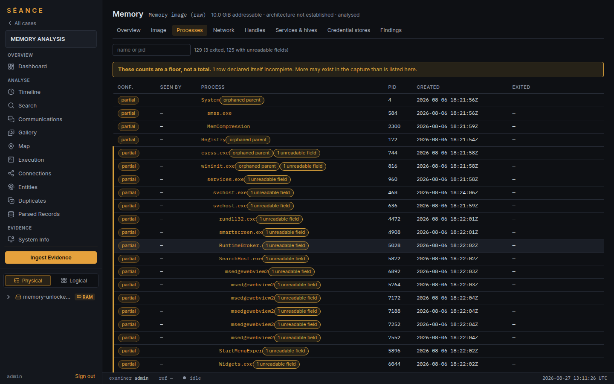
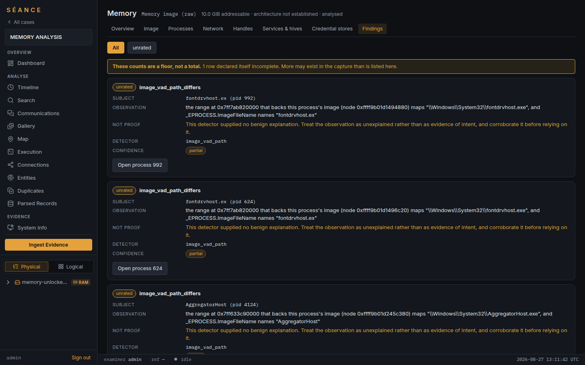
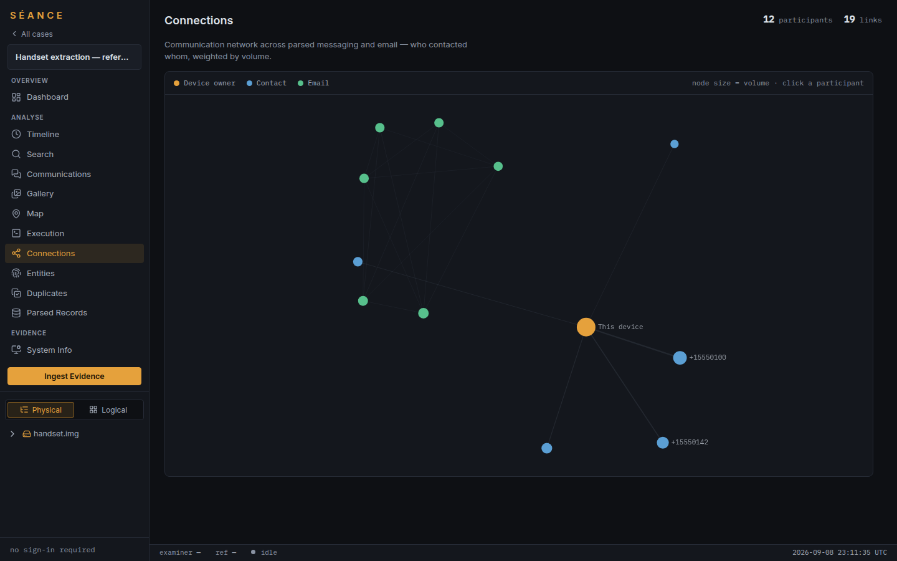
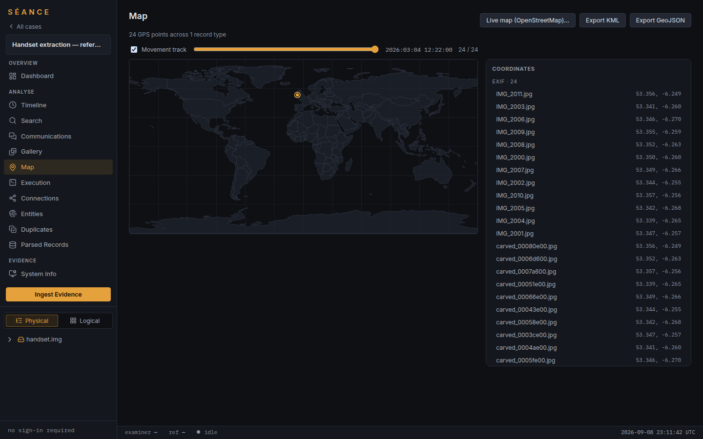
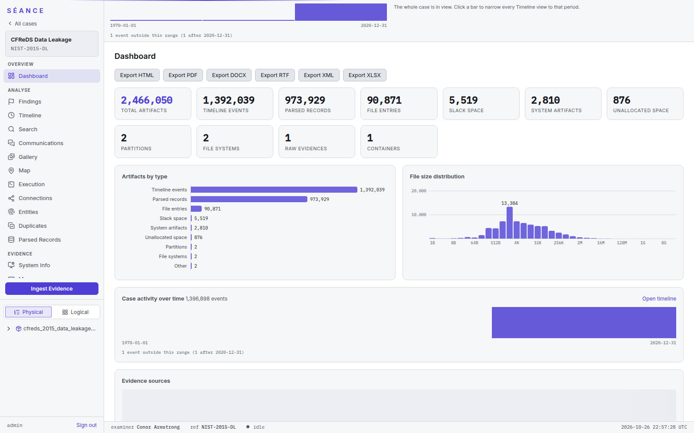
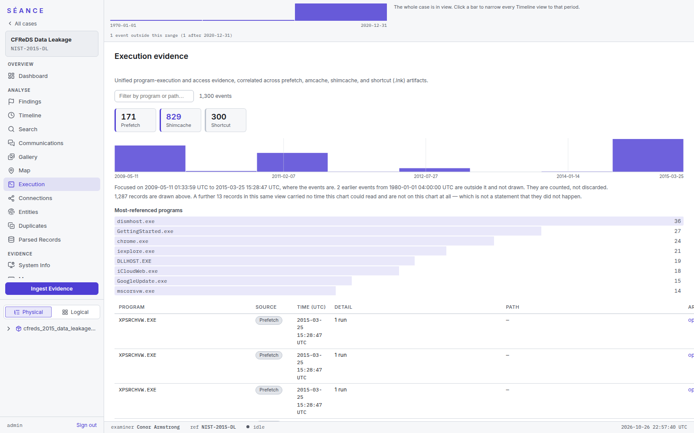

# Seance
**A High-Performance, Modular Digital Forensics Framework.**

Seance is a modern forensic analysis tool designed for speed, scalability, and flexibility. It features a zero-copy architecture, a centralized orchestrator with work-stealing parallelism, and a plug-in system for artifact parsing.

## Current Release: v1.0.1

v1.0.1 follows the first edition, v1.0.0-rc. The manifests read 1.0.1.
[CHANGELOG.md](CHANGELOG.md) holds the release notes. What comes next, in priority order with an estimate on
every item, is [ROADMAP.md](ROADMAP.md).

## Screenshots

The web UI, on public sample evidence (the SANS verify, CFReDS and NIST sets, a
synthetic handset and a Windows 11 memory capture). These are the images the
in-app help uses. The older six come from earlier builds, so treat them as
illustrations, not as a record of current output.

| | |
|---|---|
| <br>**Dashboard.** Counts, artifacts by type and activity over time. | <br>**Timeline.** Every dated event across modules, filterable, with activity, swimlane and heatmap views. |
| <br>**Memory processes.** The process tree with per-row confidence, and a banner that says the counts are a floor. | <br>**Memory findings.** Each observation states what it is not proof of. |
| <br>**Connections.** Who contacted whom across messaging and email, weighted by volume. | <br>**Map.** EXIF GPS points as a movement track, with KML and GeoJSON export. |

The light theme pair comes from this build, run against the public NIST CFReDS
2015 data-leakage image (2.4 million artifacts from one NTFS volume):

| | |
|---|---|
| <br>**Dashboard.** The same view in the light theme, over a full Windows 7 disk image. | <br>**Execution.** Prefetch, shimcache and shortcut records in one view, with a note on what the chart leaves out. |

**Tests:** 12,922 `#[test]` / `#[tokio::test]` / `#[sqlx::test]` functions
in the Rust tree (counted with
`grep -rE '^\s*#\[(tokio::|sqlx::)?test\]' --include=*.rs .` excluding
`target/` and `reference/`), plus 2,315 frontend test cases declared across 180
spec files (`it(` / `test(` at the start of a line, a declaration
count, not a `vitest run`). A declaration count is an upper bound on what a
plain `cargo test` proves — it includes corpus-gated tests that skip when their
image is absent and tests that only run under `--release`; see
[documentation/TESTING.md](documentation/TESTING.md#how-big-the-suite-is)
**Modules:** 157 built at startup with default features. The set is assembled in
one place — `seance_api::modules::build_module_set` — and the exact count is
logged when the server starts, which is the figure to quote rather than this one
**Crates:** 127 workspace members — the root manifest's `[workspace] members`
list, which is where a new crate is declared
(`sed -n '/^members = \[/,/^]/p' Cargo.toml | grep -o '"[^"]*"' | wc -l`)
**Lines of Rust:** about 950,000, tests included

Those figures are counted from the tree rather than maintained by hand, so treat
them as the scale of the thing and not as an assertion to the digit.

## What it does

A short list; [documentation/FEATURES.md](documentation/FEATURES.md) is the full account.

- **Architecture:** a zero-copy core, a `ForensicsModule` plug-in trait with content-based detection, and an orchestrator that spills to disk rather than growing without bound.
- **Evidence in:** E01/EWF, AFF4, virtual disks, sparse images, optical images, RAID and LVM, and encrypted volumes, with every refusal stated. See [Container_Formats.md](documentation/Container_Formats.md).
- **Recovery:** file carving, bulk-extractor-style feature extraction and password recovery.
- **Findings and triage:** ranked findings, a needs-attention list, CSAM triage against Project VIC and CAID, and a pivot across the case.
- **Windows, Linux and macOS artifacts:** NTFS, the Windows parser set, Linux and macOS artifact parsers.
- **Memory forensics:** process, network, handle, credential and tamper analysis, graded against real captures. See [VALIDATION.md](documentation/VALIDATION.md).
- **Network captures:** pcap and pcapng.
- **Email and messaging:** email read as an exchange, plus the messaging parsers.
- **Reports and data management:** signed reports, and a SQLite case database with artifact lineage and full-text search.

Every entry states what it cannot do beside what it can: [METHOD_STATEMENTS.md](documentation/METHOD_STATEMENTS.md) is generated from the code, and [COMPARISON.md](documentation/COMPARISON.md) is an honest comparison with commercial suites.

## Quick Start

### Install (prebuilt binaries)

Each tagged release publishes a standalone `seance` binary on the GitHub
Releases page. The release workflow builds six targets, five in its matrix and
x86_64 Windows in a job of its own. The x86_64 Windows build carries E01
support and no other native-C feature:

| Asset | Target | E01 (`e01`) | ESE/SRUM (`esedb`) | HEIC thumbnails (`heic`) | Video thumbnails (`video-thumbs`) | Notes |
| --- | --- | :-: | :-: | :-: | :-: | --- |
| `seance-linux-x86_64.tar.gz` | x86_64 Linux (glibc ≥ Ubuntu 24.04) | yes | yes | yes | yes | needs system `libewf`; bundles `libheif.so.1`, `libde265.so.0` and `seance-ewf-helper` |
| `seance-linux-aarch64.tar.gz` | aarch64 Linux (glibc ≥ Ubuntu 24.04) | yes | yes | yes | yes | as above |
| `seance-macos-x86_64.tar.gz` | Intel macOS | yes | yes | yes | yes | needs Homebrew `libewf` and `libheif`; bundles `seance-ewf-helper` |
| `seance-macos-aarch64.tar.gz` | Apple-silicon macOS | yes | yes | yes | yes | as above |
| `seance-windows-x86_64-e01-only.zip` | x86_64 Windows | yes | no | no | no | built under MSYS2 in its own job |
| `seance-windows-aarch64-no-native.zip` | ARM64 Windows | no | no | no | no | no native-C feature builds on this target |
| `seance-web-ui-<version>.tar.gz` | any | – | – | – | – | `frontend/dist`; unpack it and pass `--web-root <dir>` |
| `validation-report.{json,md}` | – | – | – | – | – | attached only when present in the tagged tree |

Every asset has a `.sha256` beside it. The feature set of each build is stated
explicitly in the workflow's matrix (`--no-default-features --features ...`),
and the ARM64 Windows asset name says what it lacks.

The Web UI is a separate asset: unpack `seance-web-ui-<version>.tar.gz` and
point `--web-root` at its `dist/` directory (or build the frontend yourself, see
[Build and run](documentation/BUILD_AND_RUN.md)). See [DEPLOYMENT.md](documentation/DEPLOYMENT.md) for the
container image, which bundles both.

### Build and run

```bash
git clone https://github.com/conorarmstrong/seance.git
cd seance
cargo build --release -p seance_cli
npm --prefix frontend install && npm --prefix frontend run build
cargo run --bin seance        # Web UI at http://127.0.0.1:8080
```

System libraries, the feature flags, the gates CI enforces and every run mode are in [documentation/BUILD_AND_RUN.md](documentation/BUILD_AND_RUN.md). Writing a module is in [documentation/MODULE_DEVELOPMENT.md](documentation/MODULE_DEVELOPMENT.md); how evidence is handled is in [documentation/EVIDENCE_HANDLING.md](documentation/EVIDENCE_HANDLING.md).

## Documentation

Detailed documentation is in the `documentation/` directory. Everything listed
here describes the code as it stands.

### Architecture

- **[CORE_DESIGN.md](documentation/CORE_DESIGN.md)**: System architecture, API
  specification, core traits, and the memory-layer `mapping()` contract
- **[MEMORY_BUILD_BINDING.md](documentation/MEMORY_BUILD_BINDING.md)**: How a
  stage declares the structure members it needs, so a build that names them
  differently fails loudly rather than reading the wrong offset

### Evidence and output

- **[REPORTING_DESIGN.md](documentation/REPORTING_DESIGN.md)**: What a report
  contains, why each section exists, and what is deliberately not configurable
- **[VALIDATION.md](documentation/VALIDATION.md)**: Reproducible known-answer
  validation, and what the case set does *not* yet cover
- **[Container_Formats.md](documentation/Container_Formats.md)**: Every
  container and image format accepted and to what depth — E01/EWF, AFF4, raw,
  VHD/VHDX/VMDK/QCOW2, ZIP and the archive expanders, Apple `.sparseimage`,
  the encrypted volumes (BitLocker, LUKS, and the FileVault refusal),
  RAID/JBOD/LVM reassembly, and the decompression ceiling

### Platform tiers

- **[LINUX_DESIGN.md](documentation/LINUX_DESIGN.md)**: Linux artifacts, the
  symbol tiers, and the ext4 swap-acquisition trap
- **[WINDOWS_DESIGN.md](documentation/WINDOWS_DESIGN.md)**: Windows artifacts
  and memory tier
- **[MACOS_DESIGN.md](documentation/MACOS_DESIGN.md)**: macOS artifacts
- **[ANDROID_DESIGN.md](documentation/ANDROID_DESIGN.md)**: Android acquisition
  and artifacts
- **[IPHONE_DESIGN.md](documentation/IPHONE_DESIGN.md)**: iOS backup handling

### Interfaces

- **[frontend/README.md](frontend/README.md)**: Web UI development and build
  guide (React + TypeScript)
- **[REPL_DESIGN.md](documentation/REPL_DESIGN.md)**: Command-line REPL

### Development and operations

- **[TESTING.md](documentation/TESTING.md)**: Testing strategy, the corpus
  gate, and the practices that came out of specific failures
- **[CI.md](documentation/CI.md)**: What runs on every push
- **[DEPLOYMENT.md](documentation/DEPLOYMENT.md)**: Deployment and operations
- **[ROADMAP.md](ROADMAP.md)**: What needs to be done and nothing else: every
  open item with a developer-day estimate, what is blocked on evidence, and
  the decisions on record so nothing is re-proposed
- **[BUGS.md](BUGS.md)**: The live defect register: what is open and what is
  undecided
- **[CHANGELOG.md](CHANGELOG.md)**: Release notes
- **[COMPARISON.md](documentation/COMPARISON.md)**: Feature matrix against the
  commercial suites (AXIOM, Cellebrite, FTK, EnCase, X-Ways, Belkasoft) and
  Autopsy — including, in the same detail, where Séance loses
### Readiness

- **[PRODUCTION_READINESS_GAPS.md](documentation/PRODUCTION_READINESS_GAPS.md)**:
  structured production-readiness assessment

## License

**MIT.** The full text is in [LICENSE](LICENSE).

Take it, fork it, ship it inside something closed, sell the result — the licence
asks for the copyright notice and nothing else. 

That is true of everything **this repository** ships: every crate, the
interface, the scripts and the documentation. It is **not** true of
every dependency, and that difference is on the record rather than rounded
away: a default build links two `LGPL-3.0-or-later` C libraries — `libewf` for
E01 images and `libesedb` for the ESE databases — so a *redistributed binary*
carries the LGPL's terms for those two, while nothing you write against Séance
takes on any copyleft obligation. Build with `--no-default-features` and they
are gone, along with the ability to read those formats.

**Strong** copyleft is excluded, and that is a CI gate rather than a promise:
`cargo deny check licenses` fails on GPL or AGPL, and the registry-hive parser
is [`seance_hive`](seance_hive/), written from the published format
specification, because the available alternative was GPL-2.0-or-later and would
have made the whole binary GPL. [LICENSING.md](LICENSING.md) records what that
took, names both LGPL libraries and says exactly what their terms ask of
someone redistributing a build. [NOTICE.md](NOTICE.md) credits the other third-party
material: the OCR models, the fonts and the test corpora.

## Contributing

Contributions are welcome! Please open an issue or pull request. Build prerequisites and test commands are in [BUILD_AND_RUN.md](documentation/BUILD_AND_RUN.md).
